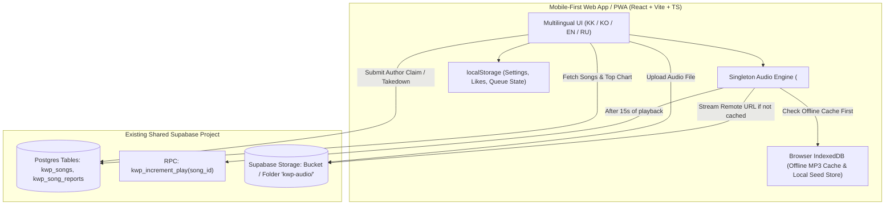

# Kazakh Worship Player — Technical Blueprint & Architecture

> **Project**: Kazakh Worship Music Player (`kazakworshipplayer`)  
> **Owner / GitHub**: `wnsqo35`  
> **Deployment Target**: Vercel (Web App / PWA first, Capacitor Android APK ready)  
> **Supported Languages**: Kazakh (`kk`), Korean (`ko`), English (`en`), Russian (`ru`)  
> **Backend**: Shared Supabase Instance (namespaced with `kwp_`) + Browser `IndexedDB` (Offline Local Storage)

---

## 1. Project Vision & Core Requirements

1. **Purpose**: A community-driven, non-commercial music player dedicated to Kazakh worship songs (`Қазақша мадақ әндері`) that have been permitted for sharing or whose original authors are unknown.
2. **Dual Upload Flow**:
   - **Developer**: Can bulk-upload or manage songs via Supabase or Admin Mode.
   - **Users**: Can upload MP3/M4A worship songs directly from the app with title, artist (defaults to "Unknown Author / Белгісіз автор" if unknown), optional lyrics, and a sharing permission confirmation.
3. **Full Audio Player Functions**:
   - Play, Pause, Next, Previous, Seek Bar scrubbing, Volume control.
   - **Repeat Modes**: Repeat Off → Repeat All (Playlist Loop) → Repeat One (Single Song Loop).
   - **Shuffle Mode**: Randomized playback queue with history preservation.
   - **Background Playback & Lock Screen Controls**: Powered by a single persistent HTML5 `<audio>` element paired with the Web `MediaSession` API so music continues when the mobile screen locks or the user switches apps.
4. **Most Played Chart**:
   - Tracks song plays and ranks songs in a dedicated **Top Chart** tab (`#1`, `#2`, `#3`, etc. with play count badges).
5. **Local Storage (`IndexedDB` + `localStorage`)**:
   - **`IndexedDB`**: Users can save/download songs directly to their phone/browser for **100% offline playback** without internet. Also supports local-only testing when Supabase env vars are not yet connected.
   - **`localStorage`**: Persists language (`kk` / `ko` / `en` / `ru`), repeat mode, shuffle state, volume, liked songs, and last played song.
6. **Copyright & Unknown Author Announcement**:
   - Prominent multilingual announcement banner + dedicated info modal + per-song **"Claim Authorship / Request Removal"** form so if an original author is found or objects to sharing, they can immediately notify the developer.

---

## 2. System Architecture



---

## 3. Shared Supabase Isolation Strategy

Because this project shares an **already existing Supabase project** with other apps, all resources are strictly isolated:

| Resource Type | Naming Convention | Details |
| :--- | :--- | :--- |
| **Songs Table** | `public.kwp_songs` | Prefixed with `kwp_` (Kazakh Worship Player) to prevent any table name collisions. |
| **Reports / Claims Table** | `public.kwp_song_reports` | Stores authorship claims, credit updates, or takedown requests. |
| **Play Counter RPC** | `public.kwp_increment_play` | Atomic Postgres function (`SET play_count = play_count + 1`) safe against concurrent plays. |
| **Storage Bucket & Folder** | Configurable via `.env` | Supports either a dedicated bucket (`kazakh-worship`) OR a subfolder (`kwp-audio/`) inside an existing shared bucket via `VITE_SUPABASE_STORAGE_BUCKET` and `VITE_SUPABASE_STORAGE_FOLDER`. |

### Environment Variables (`.env.example`)
```env
VITE_SUPABASE_URL=https://your-existing-project.supabase.co
VITE_SUPABASE_ANON_KEY=your-existing-anon-key
VITE_SUPABASE_STORAGE_BUCKET=kazakh-worship
VITE_SUPABASE_STORAGE_FOLDER=kwp-audio
VITE_ADMIN_PASSCODE=optional-admin-pin-for-quick-delete
```
> **Graceful Local Fallback**: If `VITE_SUPABASE_URL` is not set yet, the app automatically runs in **Local IndexedDB Mode** with sample Kazakh worship tracks so development, UI testing, uploads, and chart ranking work out-of-the-box.

---

## 4. Audio Engine & Background Playback Design

Mobile browsers (especially iOS Safari and Android Chrome) enforce strict media autoplay and background execution policies. To guarantee reliable background playing and automatic track transitions:

1. **Single Persistent `<audio>` Element**:
   - Never instantiate `new Audio()` per track in background callbacks (mobile browsers block un-gestured `Audio` instances when locked).
   - Mount a single global `<audio preload="auto">` element and mutate `audio.src` when advancing tracks.
2. **Offline-First Resolution**:
   - When playing `song.id`, check `IndexedDB` (`kwp_offline_blobs`) first.
   - If cached locally, play from `URL.createObjectURL(blob)` (zero bandwidth, works offline).
   - Otherwise, stream from `song.audio_url` (Supabase Storage public URL).
3. **`MediaSession` Lock Screen Integration**:
   - Updates `navigator.mediaSession.metadata` with title, artist (`Белгісіз автор` / `Unknown` if unspecified), and artwork.
   - Registers handlers for `play`, `pause`, `previoustrack`, `nexttrack`, and `seekto` so Android/iOS lock screens and Bluetooth headphones control the app natively.
4. **Accurate Play Count Tracking**:
   - Triggers `kwp_increment_play(song_id)` once per song play after the user listens for at least **10 seconds** (or 30% of short audio clips), preventing rapid next-button skips from artificially inflating the Most Played Chart.
   - Also increments when a song loops via **Repeat One**.

---

## 5. Repository Structure

```text
kazakworshipplayer/
├── AGENTS.md                  # AI handoff guide & rules for any coding agent
├── README.md                  # Quickstart, Supabase setup & Vercel deployment guide
├── docs/
│   ├── BLUEPRINT.md           # This technical architecture & roadmap document
│   ├── UI_UX_SPEC.md          # Complete UI/UX design system, wireframes & 4-lang i18n dictionary
│   ├── SUPABASE_SETUP.sql     # Non-destructive SQL setup for the shared Supabase project
│   └── ui-preview.html        # Standalone interactive HTML prototype of the UI/UX
├── public/
│   ├── manifest.json          # PWA Web App Manifest (installable on Android/iOS home screen)
│   └── icons/                 # App icons & default Kazakh ornamental cover art
└── src/                       # (Phase 2 Implementation)
    ├── main.tsx
    ├── App.tsx
    ├── i18n/                  # Translations for KK, KO, EN, RU
    ├── lib/
    │   ├── supabase.ts        # Shared Supabase client & storage helper
    │   └── localDb.ts         # IndexedDB wrapper for offline MP3 blobs & local fallback
    ├── hooks/
    │   └── useAudioPlayer.ts  # Singleton Audio + MediaSession + Repeat/Shuffle hook
    └── components/
        ├── Header.tsx
        ├── AnnouncementBanner.tsx
        ├── SongList.tsx
        ├── TopChart.tsx
        ├── OfflineLibrary.tsx
        ├── UploadModal.tsx
        ├── ReportModal.tsx
        └── PlayerBar.tsx
```

---

## 6. Deployment Plan (`wnsqo35` GitHub + Vercel)

1. **Git Setup**:
   - Initialize repository in `/Users/godiswithyou/Projects/kazakworshipplayer`
   - Push to `https://github.com/wnsqo35/kazakworshipplayer` (or user-preferred repo name under `wnsqo35`).
2. **Shared Supabase Setup**:
   - Run `docs/SUPABASE_SETUP.sql` in the existing Supabase SQL Editor.
   - Copy `VITE_SUPABASE_URL` and `VITE_SUPABASE_ANON_KEY` into Vercel Environment Variables.
3. **Vercel Deployment**:
   - Import the GitHub repository into Vercel (`Framework Preset: Vite`).
   - Add the environment variables and click **Deploy** (\$0/month Hobby tier).
4. **Optional Android APK Wrap (Later)**:
   - Run `npx cap init` + `npx cap add android` or use **PWABuilder.com** against the live Vercel URL to generate a signed Android `.apk` / `.aab`.

---

## 7. Implementation Checklist

- [x] **Phase 1: Blueprint & Documentation**
  - [x] Architecture & Shared Supabase Isolation Strategy (`docs/BLUEPRINT.md`)
  - [x] UI/UX Design Spec & 4-Language Dictionary (`docs/UI_UX_SPEC.md`)
  - [x] Non-destructive Shared Supabase SQL Schema (`docs/SUPABASE_SETUP.sql`)
  - [x] Interactive UI/UX Prototype (`docs/ui-preview.html`)
  - [x] Multi-Agent Handoff File (`AGENTS.md`)
- [ ] **Phase 2: Core Web App / PWA Implementation**
  - [ ] Scaffold Vite + React + TypeScript + Tailwind CSS
  - [ ] Implement 4-Language i18n Context (`KK`, `KO`, `EN`, `RU`)
  - [ ] Implement `IndexedDB` Offline Audio Cache + Local Fallback Store
  - [ ] Implement Shared Supabase Service (`kwp_songs`, `kwp_song_reports`, Storage upload)
  - [ ] Build Singleton Audio Player with Repeat (`off`/`all`/`one`), Shuffle, Seek, and `MediaSession` API
- [ ] **Phase 3: Feature Screens & Copyright Flows**
  - [ ] All Songs View + Search + Category Filter
  - [ ] Most Played Chart Leaderboard View
  - [ ] Offline Saved Songs View
  - [ ] Song Upload Modal with Sharing Consent
  - [ ] Unknown Author Announcement Banner + Claim Authorship / Removal Request Modal
- [ ] **Phase 4: Git (`wnsqo35`) & Vercel Deployment**
  - [ ] Commit & push to `wnsqo35` GitHub repo
  - [ ] Connect shared Supabase credentials & deploy to Vercel
